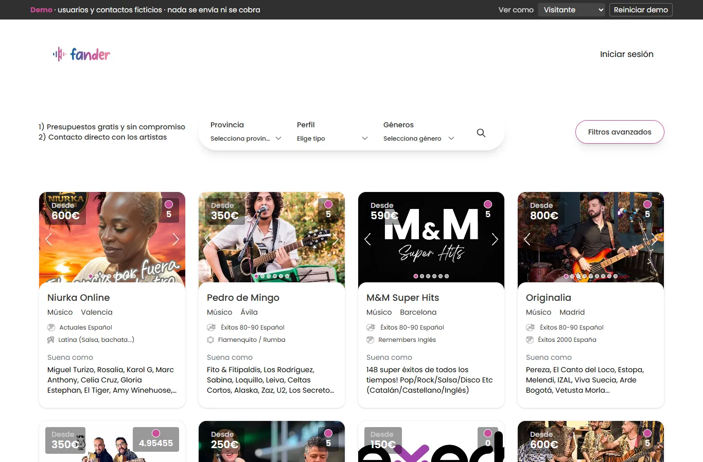
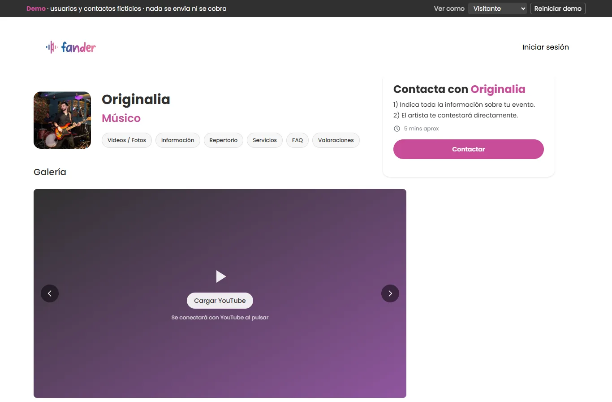
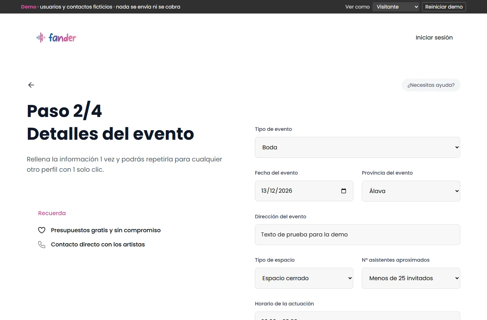
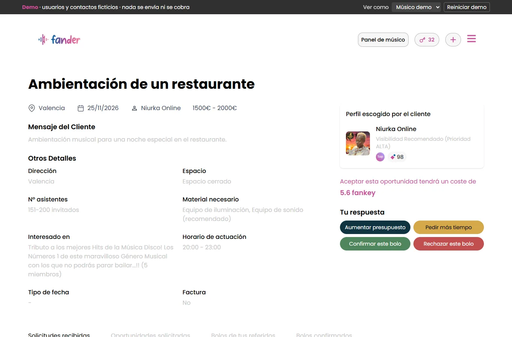
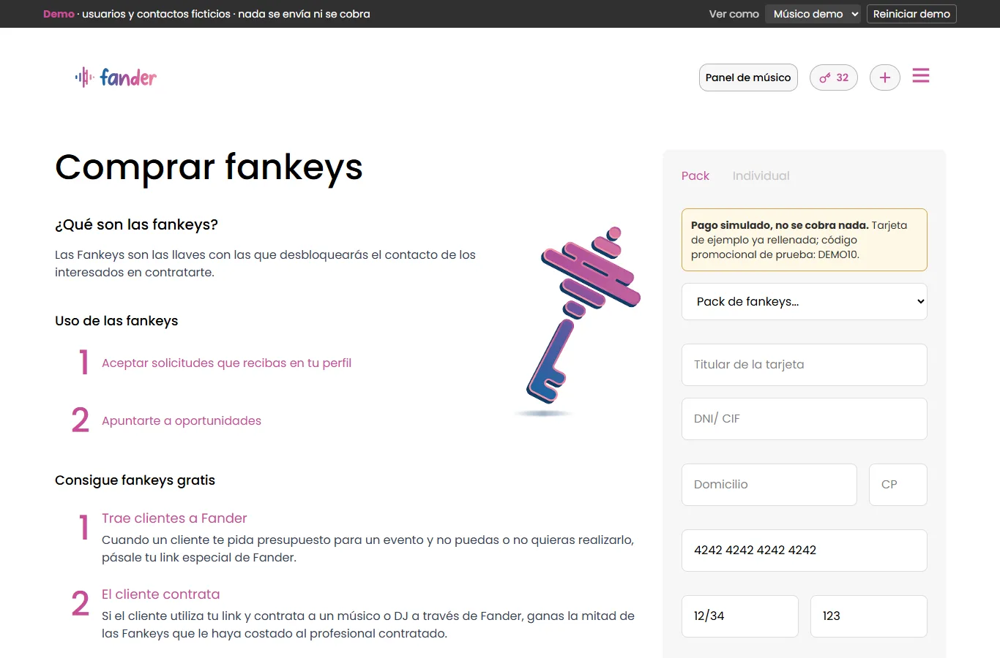
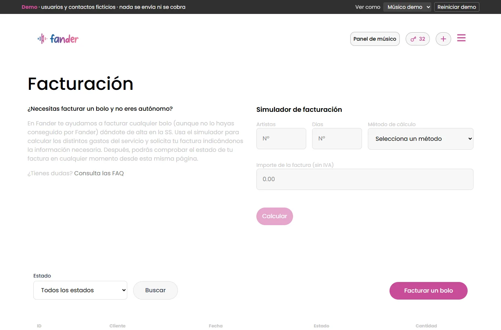
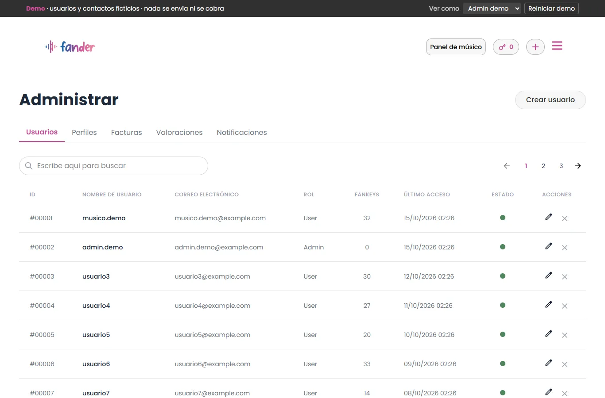
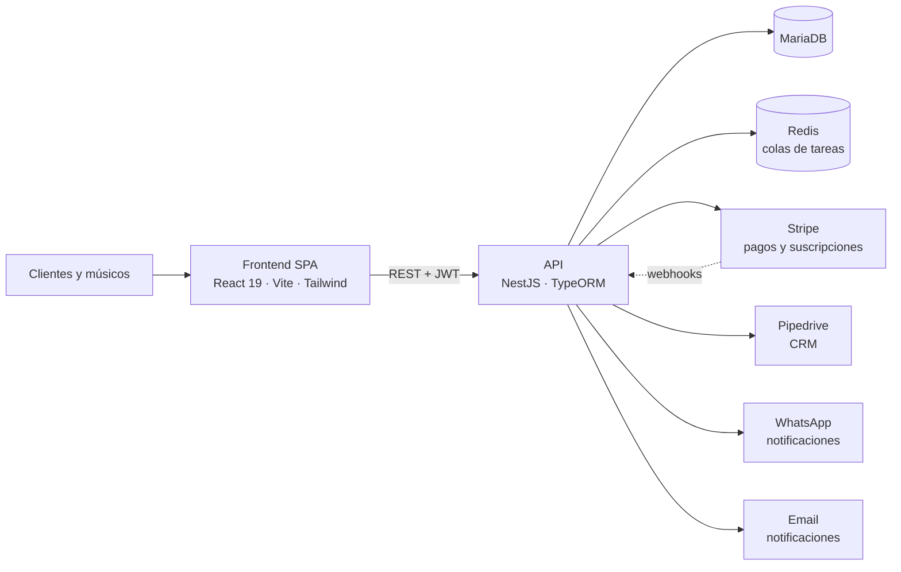

# Fander · demo de portfolio

**▶ Demo en vivo: https://ignaciomabor.github.io/fander-demo/**

> ⚠️ **Los usuarios, clientes y datos de contacto que aparecen son ficticios.** Nada se envía ni se cobra: todas las acciones (solicitudes, pagos, facturas…) se simulan en tu navegador y se reinician con el botón "Reiniciar demo".

Fander es un marketplace español para **contratar músicos y DJs para eventos** (bodas, empresas, fiestas, restaurantes, hoteles). Los clientes encuentran artistas y les piden presupuesto; los músicos gestionan sus solicitudes, se apuntan a oportunidades publicadas por clientes, mejoran su visibilidad y facturan sus actuaciones sin ser autónomos.

Este repositorio contiene **solo la versión compilada** de una demo estática del frontend. El backend no está incluido y la demo no se conecta a ningún servidor.

## Qué puedes probar

Usa la barra superior **"Ver como"** para cambiar entre *Visitante*, *Músico demo* y *Admin demo*.

| Rol | Funcionalidades |
|---|---|
| Visitante | Buscador con filtros, perfiles de músicos (galería, repertorio, servicios, FAQ, valoraciones), solicitud de presupuesto en 4 pasos, publicar una oportunidad, valorar a un músico, páginas de ciudad |
| Músico | Panel con métricas, gestión de solicitudes (confirmar, aplazar, subir presupuesto, rechazar, ganada/perdida), oportunidades e inscripción, edición de perfiles, compra de Fankeys (pago simulado), planes de visibilidad, facturación con calculadora de IRPF/Seguridad Social y asistente de facturas |
| Admin | Gestión de usuarios y de facturas |

## Capturas

| | |
|---|---|
|  |  |
|  |  |
|  |  |
|  |  |

## Arquitectura del sistema real

En esta demo, la API se sustituye por un **servidor simulado en el navegador**: un adaptador de axios responde a todas las peticiones con la misma forma que la API real, a partir de una muestra de perfiles públicos de músicos y de datos generados (usuarios, clientes, facturas, pagos).

## Stack

- **Frontend:** React 19, Vite 6, Tailwind CSS 4, React Router 7, TanStack Query 5, Axios, Formik + Yup, react-hot-toast
- **Backend (no incluido):** NestJS, TypeORM, MariaDB, Redis, Stripe, Pipedrive, WhatsApp, email
- **Demo:** mock de API en el navegador, pago simulado, sesión de demo, sin analítica ni cookies de seguimiento, `noindex`

## Privacidad

- Perfiles públicos de una muestra de músicos (nombre artístico, fotos, vídeos, repertorio), tal y como aparecen en la web.
- Todos los usuarios, clientes, emails, teléfonos, direcciones, NIF e IBAN son **inventados** (`@example.com`, `+34 600 …`, "DOCUMENTO DE EJEMPLO").
- Los textos libres de clientes se han sustituido por textos genéricos y las imágenes se han re-codificado sin metadatos.

---

## English (short)

**Live demo: https://ignaciomabor.github.io/fander-demo/**

Fander is a Spanish marketplace to **book musicians and DJs for events**. This repository contains only the **compiled build of a static frontend demo**: the backend is not included and the API is replaced by an in-browser mock. Use the top bar to switch between *Visitor*, *Demo musician* and *Demo admin*.

**All users, clients and contact details are fictitious.** Nothing is sent or charged; every action is simulated in your browser.

Stack: React 19 · Vite · Tailwind · React Router · TanStack Query · (real system: NestJS · MariaDB · Redis · Stripe · Pipedrive · WhatsApp).
